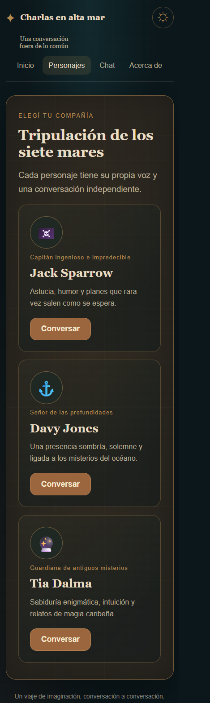
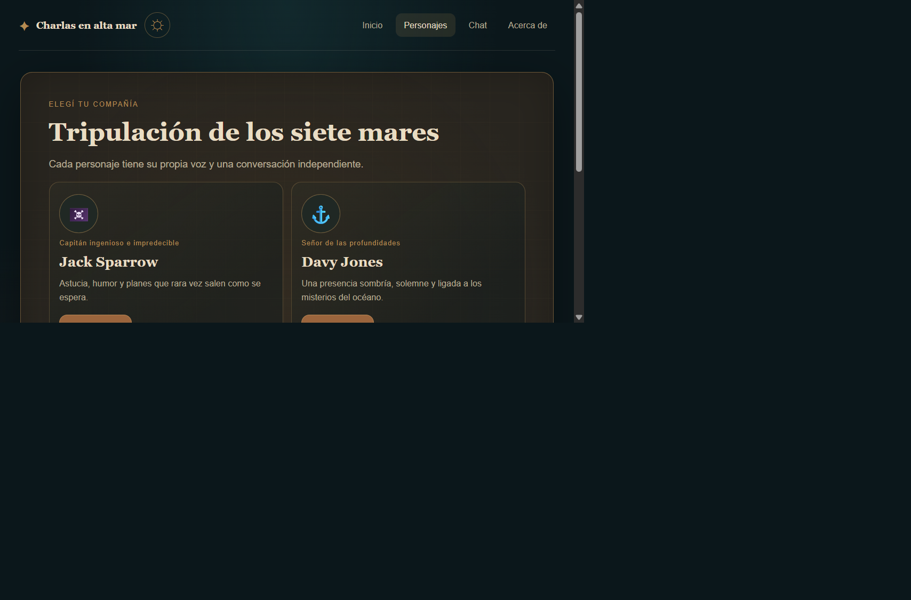
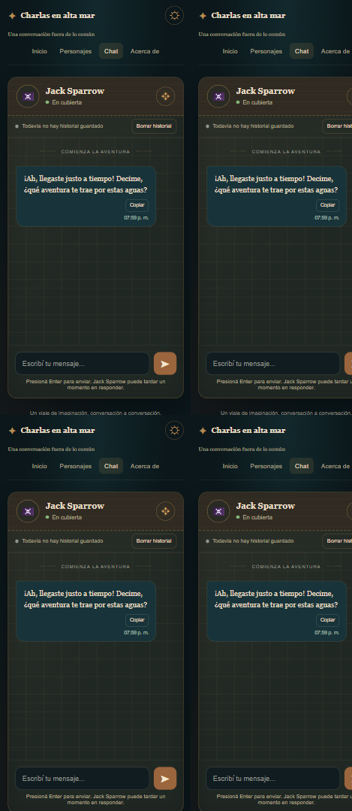

# Charlas en alta mar

Este proyecto lo hice como parte del trayecto de Soy Henry. La idea fue armar una SPA para conversar con personajes del mundo pirata y practicar navegación, diseño responsive, consumo de una API de IA y funciones serverless.

La aplicación está publicada en [proyecto-m3-rho.vercel.app](https://proyecto-m3-rho.vercel.app).

## Personaje elegido

El personaje principal es **Jack Sparrow**: un capitán ingenioso, teatral e impredecible que habla con humor, metáforas marítimas y confianza en sus propios planes. Como extra de la aplicación, la galería también incluye a **Davy Jones**, asociado con las profundidades y las deudas del mar, y a **Tia Dalma**, presentada como una consejera enigmática y sabia.

Los personajes no reproducen diálogos ni escenas de las películas. El sistema prompt define rasgos generales, respuestas cortas de una o dos frases y un tono propio para cada personalidad.

## ¿Qué se puede hacer?

- Navegar entre Inicio, Personajes, Chat y Acerca de sin recargar la página.
- Elegir entre Jack Sparrow, Davy Jones y Tia Dalma. Cada personaje tiene su propio prompt y conversación.
- Mantener los historiales en `localStorage`, incluso al recargar, o borrarlos desde el chat.
- Enviar mensajes con el botón o con Enter, ver cuándo responde el personaje y copiar sus respuestas.
- Cambiar entre tema oscuro y claro.
- Usar la interfaz en celular, tablet y escritorio.

Las personalidades están definidas con prompts propios en el servidor. Buscan evocar rasgos generales de cada personaje, sin copiar diálogos ni escenas de las películas.

## Capturas

Estas capturas muestran la galería y el chat en distintos tamaños:

### Galería en celular



### Galería en escritorio



### Chat en celular



## Uso de IA durante el proyecto

### IA usada por la aplicación

Google Gemini se usa para generar las respuestas del chat. La aplicación utiliza el modelo `gemini-3.5-flash-lite`.

El frontend envía el historial completo y el identificador del personaje seleccionado a la función serverless `/api/chat`. Desde el servidor se valida la petición, se elige el system prompt correspondiente y se consulta Gemini con `GEMINI_API_KEY`.

La clave no se incluye en el JavaScript del cliente. Las respuestas recibidas se transforman y se muestran en la interfaz. Las conversaciones se guardan en `localStorage`, separadas por personaje, y pueden borrarse desde cada chat.

### Registro de uso de IA en el desarrollo

| Tipo de uso | Herramienta | Para qué se utilizó |
| --- | --- | --- |
| IA de la aplicación | Google Gemini | Generar respuestas conversacionales según el personaje seleccionado |
| Apoyo al desarrollo | Copilot | Ayudar a revisar el código, diseñar mejoras de interfaz, organizar archivos y documentar la implementación |

Las indicaciones del sistema se encuentran en `api/chat.js` y contienen la personalidad, el tono de respuesta y las limitaciones de los personajes. Se utilizaron prompts propios y originales; no se reproducen diálogos ni escenas exactas de las películas.

## Tecnologías

- HTML, CSS y JavaScript (ES modules)
- Vite
- Vercel Functions
- Google Gemini API
- Vitest

## Para correrlo localmente

Necesitás Node.js 20.19 o superior y npm.

1. Cloná el repositorio y entrá a la carpeta:

   ```bash
   git clone https://github.com/Caterinacoaloa/proyecto-m3.git
   cd proyecto-m3
   ```

2. Instalá las dependencias:

   ```bash
   npm install
   ```

3. Iniciá sesión y vinculá el proyecto con Vercel si todavía no lo hiciste:

   ```bash
   npx vercel login
   npx vercel link
   ```

4. En Vercel, asegurate de tener configurada la variable `GEMINI_API_KEY` para Development. Después descargá la configuración local:

   ```bash
   npx vercel env pull .env.local
   ```

   `.env.local` contiene información privada, no se debe subir al repositorio ni compartir. Está incluido en `.gitignore`.

5. Iniciá la aplicación con Vercel para que también estén disponibles las funciones de `/api`:

   ```bash
   npx vercel dev
   ```

   La terminal muestra la dirección local donde quedó corriendo. `npm run dev` sirve para trabajar solo en la parte de Vite; para probar el chat con Gemini localmente, usá `npx vercel dev`.

## Tests y compilación

Para correr los tests:

```bash
npm test
```

Para generar la compilación de producción:

```bash
npm run build
```

## Cómo está organizado

```text
api/                 Función serverless que consulta Gemini
src/
  app.js             Routing y lógica principal de la SPA
  chat.js            Personajes y lógica específica del chat
  utils.js           Validación, transformación y persistencia
  styles.css         Diseño responsive y temas
tests/
  app.test.js        Tests de la configuración del chat
  chat.test.js       Tests de la función serverless
  utils.test.js      Tests de transformación y persistencia
index.html           Punto de entrada de Vite
```

La clave de Gemini se usa únicamente en la función serverless y se configura como variable de entorno. No debe escribirse en el código del cliente.

## Despliegue

La aplicación está desplegada en Vercel. Para publicar una nueva versión desde una copia ya vinculada al proyecto:

```bash
npx vercel --prod
```

Si se modifica `GEMINI_API_KEY` en Vercel, hace falta generar un nuevo despliegue para que el cambio entre en vigencia.
